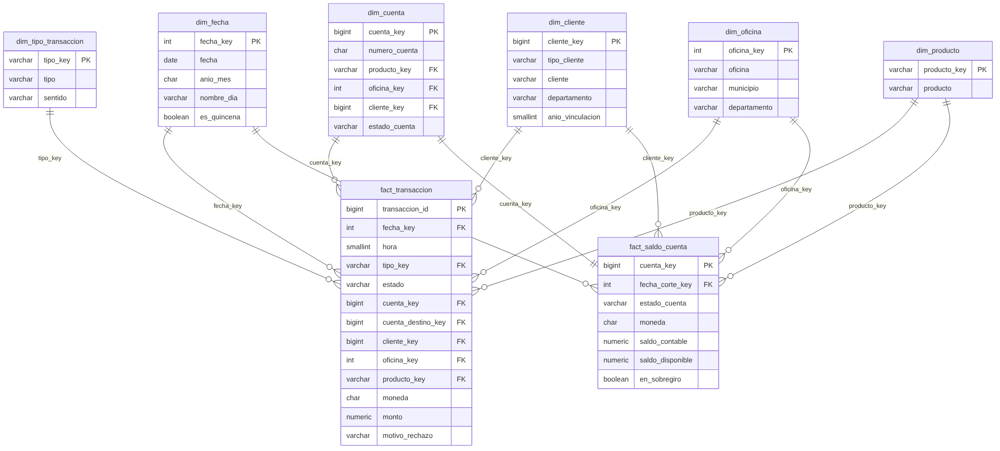

# B2 · El modelo estrella del Banco Andino

Para los tableros no usamos directamente las tablas del banco (ref, core, fin), porque están
pensadas para operar, no para analizar. Armamos un modelo estrella en la misma base, en un
esquema aparte llamado `bi`, y lo llenamos con un procedimiento que se puede repetir.

## Qué preguntas queremos responder

- ¿Cuánta plata mueve el banco, de qué tipo y en qué meses, días y horas?
- ¿Cuántas operaciones se rechazan y por qué?
- ¿Cuántas cuentas y clientes tenemos, de qué productos y en qué regiones?
- ¿Cuánto saldo hay al corte y cuántas cuentas están en sobregiro?
- ¿Los datos cuadran? (débitos = créditos, saldo = ledger, calidad de G6)

## Hechos

| Tabla | Grano (una fila es…) | Filas | Medidas |
|---|---|---|---|
| `bi.fact_transaccion` | Una transacción financiera (contabilizada, rechazada o pendiente) | 1.024.178 | monto, conteos |
| `bi.fact_saldo_cuenta` | Una cuenta en la fecha de corte (foto) | 50.000 | saldo contable, saldo disponible, sobregiro |
| `bi.fact_control` | Un control de cuadre o calidad | 6 | valor obtenido y resultado |

Además cargamos `bi.calidad_prueba` con las 76 pruebas del quality gate de G6, y la vista
`bi.v_calidad_puntaje` recalcula el puntaje con la misma fórmula de G6 (99,6).

## Dimensiones

| Tabla | Una fila es… | Filas | Atributos para filtrar |
|---|---|---|---|
| `bi.dim_fecha` | Un día | 4.261 | año, trimestre, mes, año-mes, día de la semana, fin de semana, quincena |
| `bi.dim_cuenta` | Una cuenta | 50.000 | número, producto, moneda, oficina, titular principal, estado, año de apertura |
| `bi.dim_cliente` | Un cliente | 10.000 | tipo (natural o jurídica), nombre, estado, municipio, departamento, año de vinculación |
| `bi.dim_oficina` | Una oficina | 87 | oficina, municipio, departamento |
| `bi.dim_producto` | Un producto | 4 | producto, si permite sobregiro |
| `bi.dim_tipo_transaccion` | Un tipo | 7 | tipo y sentido (entrada, salida, movimiento o corrección) |

Las dos tablas de hechos comparten las dimensiones, así que en Power BI un mismo filtro (por
ejemplo, producto u oficina) aplica a transacciones y a saldos a la vez.

## Decisiones que tomamos

1. **Lo pusimos en la misma base**, en el esquema `bi`, como decidimos al arrancar la fase. Así
   no hay que copiar datos a otro lado y el modelo se recarga en unos 30 segundos.
2. **Una transacción se asigna a una sola cuenta:** la de origen si tiene, y si no, la de
   destino. Para las transferencias guardamos también la cuenta destino (`cuenta_destino_key`),
   pero el monto se cuenta una sola vez. Así la suma de montos es igual a la del banco.
3. **La fecha de la transacción** es la fecha contable si está contabilizada, y la fecha de
   solicitud si fue rechazada o está pendiente (esas no tienen fecha contable).
4. **El cliente de una cuenta es su titular principal**: el vigente o, si ya no tiene (por
   ejemplo, cuentas cerradas), el último que tuvo. Así ninguna cuenta queda sin cliente.
5. **Los saldos son una foto al corte** (31/08/2026, la última fecha contable). No se suman entre
   fechas, igual que en Retail 360.
6. **Pesos y dólares nunca se suman juntos.** Todos los indicadores de dinero van por moneda.
7. **Power BI entra con un usuario de solo lectura** (`powerbi_lector`, del rol `banco_bi`) que
   solo ve el esquema `bi`. Lo probamos: puede leer `bi`, pero no puede leer `core.cuenta` ni
   escribir en `bi`. La contraseña no va en el repositorio; cada uno la pone en su PC.

## Cómo lo corrimos

Con la base `banco_andino_lab` ya cargada (G8), le dimos doble clic a `ejecutar_b2.bat`, pusimos
la contraseña de PostgreSQL y corrió los 5 scripts de la carpeta `sql/` en orden:

| Script | Qué hace |
|---|---|
| `b2_01_esquema_bi.sql` | Crea el esquema `bi`, las tablas y el procedimiento `bi.cargar_bi()` |
| `b2_02_cargar_bi.sql` | Trae el resultado de G6 y llena dimensiones y hechos |
| `b2_03_rol_powerbi.sql` | Crea el rol de solo lectura y prueba sus permisos |
| `b2_04_validar_bi.sql` | Compara el modelo con el banco (14 controles) y repite la carga |
| `b2_05_kpi_referencia.sql` | Calcula los valores oficiales de los indicadores |

Lo que salió queda en `salidas/salida_b2.txt`.
